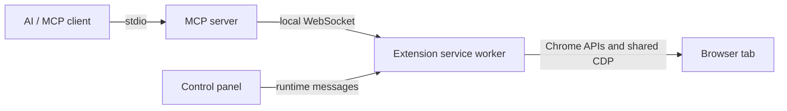

# BrowserMCP Extended · Chrome Extension

[](https://github.com/NEO10111/browsermcp-extended-extension/actions/workflows/ci.yml)
[](LICENSE)
[](manifest.json)

**A compact browser control panel that connects your existing Chrome session to AI clients through a local MCP server.**

BrowserMCP Extended provides navigation, page inspection, interactions, screenshots,
JavaScript execution, and HTTP/WebSocket capture in the browser you already use.
The extension is the browser-side component; the companion
[BrowserMCP Extended MCP server](https://github.com/NEO10111/browsermcp-extended-mcp)
exposes **39 tools** over the Model Context Protocol.

This is an independent modified project. See [NOTICE](NOTICE) for upstream credits.
Version **2.0.0** is intended to be used with the **2.x MCP server**.

## Features

- **Compact control panel:** dark desktop-plugin styling, Lucide icons, collapsible
  activity and connection settings, and a browser tab picker.
- **Persistent ON/OFF:** pause automation, close the local WebSocket, stop network
  captures, and prevent automatic reconnection until re-enabled.
- **Visible connection state:** distinguish disabled, connecting, connected, and
  waiting states; configure the port and operation timeout.
- **Browser automation:** navigate, inspect visible interactive elements, type,
  click, select options, scroll, manage tabs, and capture images.
- **CDP operations:** evaluate JavaScript, target a frame, assign files to file
  inputs, and share debugger attachments with ongoing network captures.
- **Network inspection:** capture HTTP requests, responses, redirects, failures,
  and WebSocket frames; inspect details, filter records, and export HAR.
- **Local transport:** connect to `127.0.0.1:9877`; no project account or hosted
  relay is required. Results are delivered to your MCP client.

## Quick start

### 1. Install the extension

```sh
git clone https://github.com/NEO10111/browsermcp-extended-extension.git
```

Open `chrome://extensions`, enable **Developer mode**, choose **Load unpacked**,
and select the cloned directory containing `manifest.json`. No build step or npm
installation is required to use the extension. Pin it to the toolbar if desired.

### 2. Install the companion server

In the same parent directory:

```sh
git clone https://github.com/NEO10111/browsermcp-extended-mcp.git
cd browsermcp-extended-mcp
npm ci
```

Use Node.js **22 or newer**. Register the server with your MCP client using an
absolute path to `server.js`. For Codex, add this to `~/.codex/config.toml`:

```toml
[mcp_servers.browsermcp-extended]
command = "node"
args = ["/absolute/path/browsermcp-extended-mcp/server.js", "--execute-port", "9877"]
```

The MCP client starts the server over stdio. Restart the client after configuring
it. Use an absolute Node executable path if your desktop client cannot find
`node`. Other clients can use the [generic configuration](https://github.com/NEO10111/browsermcp-extended-mcp#client-configuration).

### 3. Connect and verify

Open the extension popup and turn automation **On**. The status should become
**Connected**. Ask your client to list browser tabs or open a disposable test page.
The client should discover **39 tools**.

## Control panel

| Control | Behavior |
| --- | --- |
| ON/OFF switch | Persists `mcpEnabled`; OFF stops captures and disconnects automation |
| Connection status | Shows transport availability separately from activation |
| Active tab | Shows the page title/domain; the picker activates a chosen tab and window |
| Activity | Shows the 30 most recent recorded commands, durations, and errors |
| Port | Local WebSocket port; default `9877`, valid range `1–65535` |
| Timeout | JavaScript operation timeout; default `15 s`, valid range `1–300 s` |

The shortcut **Alt+J** opens the popup unless overridden in Chrome. Network captures
are controlled through MCP tools; the popup is not a DevTools Network panel.

## Network capture workflow

1. Call `browser_network_start` on the desired `tabId`.
2. Reload the page or perform the action to observe **after capture starts**.
3. Call `browser_network_list`, optionally filtering by URL, method, status, or type.
4. Pass a returned request `id` to `browser_network_detail` as `requestId`.
5. Export with `browser_network_export_har`, then stop with `browser_network_stop`.

Keep using the same `tabId` when inspecting a capture, even if another tab becomes
active. Requests from before capture started cannot be recovered. See
[network behavior and limits](docs/NETWORK.md) for retention, truncation, and scope.

## Permissions and privacy

| Permission | Purpose |
| --- | --- |
| `tabs` | List, select, create, navigate, reload, and close browser tabs |
| `scripting` | Run targeted DOM inspection and interaction functions |
| `debugger` | CDP JavaScript, screenshots, frames, file inputs, and network events |
| `cookies` | Read cookies through the browser API |
| `storage` | Persist activation, port, and timeout preferences |
| `alarms` | Retry the local connection while the extension is enabled |
| `<all_urls>` | Allow authorized automation across web origins |

The published extension does not inject a historical third-party content bundle
into every page. DOM tools inject functions when called. It uses your real browser
profile and therefore has access to that profile's authenticated sessions.
Network captures can contain cookies, tokens, and personal content. Tool results
leave the extension for your MCP client; that client may send them to its model
provider. Read [SECURITY.md](SECURITY.md) before exposing sensitive pages.

## Development and verification

```sh
npm ci
npm run check
npm test
```

The extension has no runtime npm dependencies. Node.js is needed only for local
checks and tests. The suite covers activation, settings, reference-based DOM
operations, CDP frame/file handlers, debugger sharing, network capture and HAR.
GitHub Actions runs checks and tests on Node.js 22 and 24.

The server repository includes a real Chromium fixture:

```sh
cd ../browsermcp-extended-mcp
BROWSERMCP_EXTENSION_PATH=../browsermcp-extended-extension npm run test:browser
```

Set `CHROMIUM` if the browser is not at `/usr/bin/chromium`. The test uses a
separate profile, temporary HTTP/WebSocket server, and temporary extension copy;
it does not automate your normal browser profile.

## Architecture



| File | Responsibility |
| --- | --- |
| `background/background-loader.js` | Loads the classic MV3 service worker modules |
| `background/debugger-session.js` | Reference-counted CDP attachment ownership |
| `background/network-api.js` | Per-tab network capture, filtering, details, and HAR |
| `background/legacy-api.js` | Navigation, snapshots, and DOM interactions |
| `background/execute-script-api.js` | Local socket, routing, activation, and other browser handlers |
| `popup/` | Compact HTML/CSS/JavaScript control panel |
| `tests/` | Dependency-free Node.js tests with mocked Chrome APIs |

See [architecture and protocol](docs/ARCHITECTURE.md) for message envelopes and
[known limitations](docs/LIMITATIONS.md) for implementation boundaries.

## Troubleshooting

- **Waiting for server:** verify the client is running the companion server and
  both ends use the same port. Check MCP stderr logs.
- **Connected but no tools:** fully restart the MCP client after an update. Both
  the server process and its tool catalog must be refreshed.
- **Capture is empty:** start capture first, then reload or trigger network traffic.
  The browser may serve resources from cache; these can still appear in the list.
- **Debugger detached:** inspect `stoppedReason`; DevTools, tab closure, or browser
  actions may terminate an attachment. Start a new capture if needed.
- **Restricted page:** Chrome internal pages and some protected origins cannot be
  scripted. Test against an ordinary HTTP(S) page.

After editing background files, reload the extension in `chrome://extensions`.
After changing tool definitions, restart the MCP client too. Full details are in
the companion server's [troubleshooting guide](https://github.com/NEO10111/browsermcp-extended-mcp/blob/main/docs/TROUBLESHOOTING.md).

## Contributing and license

See [CONTRIBUTING.md](CONTRIBUTING.md), [SECURITY.md](SECURITY.md), and
[CHANGELOG.md](CHANGELOG.md). Code is distributed under [Apache License 2.0](LICENSE).
Lucide/Feather icon notices are retained in [THIRD_PARTY_NOTICES.md](THIRD_PARTY_NOTICES.md).
